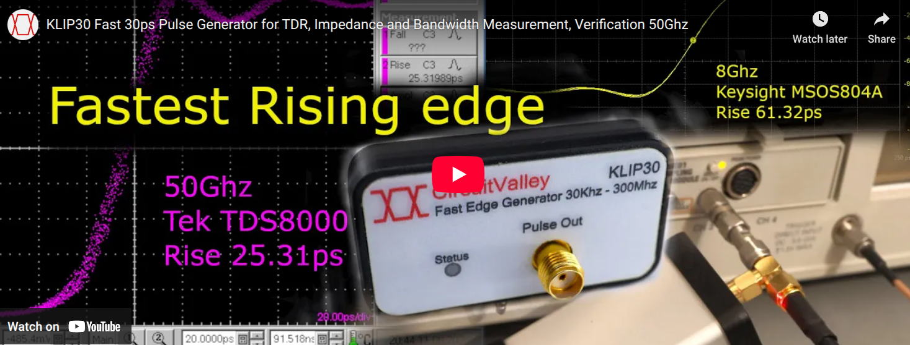
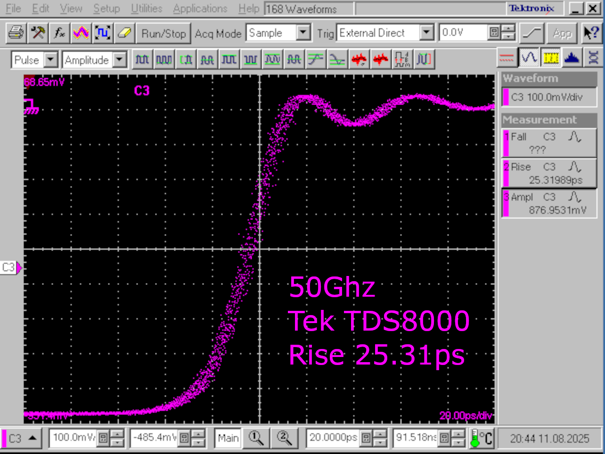

# KLIP30 Programmable 30ps Fast Pulse Generator

USB programmable fast-edge pulse generator: 30 ps rise, ~20 ps fall, 50–1300 mV into 50 Ω, 30 kHz – 300 MHz.

## Ways to program: no installation, no driver

The KLIP30 is a composite USB device (HID + USB serial port), so you can use:

- **KLIP30 app**: portable GUI for Windows, Linux and macOS. Just start it.
- **Text commands**: any serial terminal at 115200 baud, e.g. `FREQ 12.5M`, `AMP 600`, `SAVE`. `HELP` lists all.
- **Your own scripts**: Python, LabVIEW, MATLAB … over the same serial port.

## Specifications

- Rise / fall time: 30 ps / ~20 ps (uncertainty +1.6 ps / −1.8 ps)
- Output: 50–1300 mV, DC-coupled, 50 Ω, 27 GHz SMA
- Repetition rate: 30 kHz – 300 MHz (PLL), 50% duty cycle
- Default: 10 MHz, 800 mV, trigger output on
- AUX in/out: AC-coupled 1.8 Vpp; external reference 10–25 MHz; trigger and multi-device / GPSDO sync
- Internal oscillator: 25 ppm initial, 2.5 ppm/year ageing
- Settings stored in high-endurance flash: runs standalone without a PC
- USB-C, 5 V ~250 mA; firmware updates over USB
- Extruded aluminium enclosure, user-serviceable
- In the box: KLIP30, SMA–SMA and SMA–BNC adapters, individual measurement report

## More

- [Datasheet](KLIP30_Datasheet.pdf) · [User Guide](KLIP30_User_Guide.pdf) · [Blog post](https://www.circuitvalley.com/2025/08/klip30-fast-pulse-generator-fast-rise-time-for-tdr-bandwidth.html)
- Linux: copy [Linux/92-cvklip30.rules](Linux/92-cvklip30.rules) to `/etc/udev/rules.d/`, then replug the KLIP30.
- 
### Blog Post

https://www.circuitvalley.com/2025/08/klip30-fast-pulse-generator-fast-rise-time-for-tdr-bandwidth.html
  
### YouTube
   

  
  
 
_NEW.JPG)

.JPG)

.JPG)

